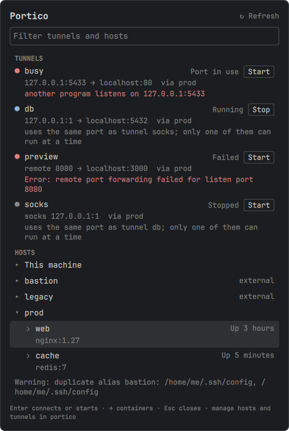

# Portico

Portico is a fast, keyboard-first interface for managing OpenSSH hosts on Linux. It provides both a terminal UI and a direct CLI while leaving OpenSSH in control of connections and effective configuration.

Portico manages hosts, adopts existing ones from your own SSH configuration, tests connections on demand, shows which identities each host uses and whether they are available, opens shells in Docker containers, and starts and stops saved tunnels. It prints JSON for scripts, and a Quickshell desktop panel (also an Omarchy plugin) connects to hosts and starts and stops tunnels from the desktop. Further work is on the [roadmap](ROADMAP.md).

## What V1 does

- Lists Portico-managed and existing OpenSSH hosts in one inventory.
- Adds, edits, inspects, renames, and removes managed hosts.
- Shows the effective configuration reported by `ssh -G`.
- Connects in the current terminal or through `xdg-terminal-exec`.
- Adopts hosts from your own SSH configuration into Portico, and exports them back, with a preview first.
- Tests on demand whether a host's login works, without opening a shell.
- Shows which identities each host offers (key files, agent keys, including 1Password's SSH agent) and whether each is available, without ever reading a private key.
- Lists the running Docker containers on this machine or a host, grouped by Compose project, and opens a shell in one.
- Saves port forwards as named tunnels and starts or stops them on demand, as ordinary `ssh` processes that keep running after Portico exits.
- Prints one versioned JSON document per command for scripts and desktop panels.
- Comes with a desktop panel for Quickshell and Omarchy to open hosts and container shells in a new terminal and to start and stop tunnels.
- Provides a master-detail TUI when run without a subcommand.
- Supports normal terminal paste into filters and host fields.
- Preserves existing SSH configuration and treats externally configured hosts as read-only until you adopt them.

Portico owns only `~/.ssh/portico/config` and, for saved tunnels, `~/.ssh/portico/tunnels`, which OpenSSH never reads. Besides `init`'s one-line `Include`, `adopt` and `export` are the only operations that change your own SSH configuration files, and each shows a preview and asks for confirmation first (unless `--yes`). Trusting a host key in the connection test appends it to your `known_hosts` file. Initialization adds an `Include ~/.ssh/portico/config` line to `~/.ssh/config` when needed and previews the change before applying it. Managed updates are validated with OpenSSH before activation and keep the previous valid fragment at `~/.ssh/portico/config.bak`. Each update probes only the added or changed aliases, so its cost does not grow with the number of managed hosts. Host values are validated up front: hostnames and users are single values, identity files may contain inner spaces but not blank or padded values, and ProxyJump values contain no whitespace (OpenSSH validates their destinations).

Private keys remain where they already live. Portico stores identity-file references but never reads, copies, or takes ownership of private-key contents. To show identities it only checks that key files exist, reads public key files with `ssh-keygen -l`, and asks agents for their public key list with `ssh-add -l`; it never generates keys, loads them into an agent, or asks an agent to sign.

## Requirements

- Linux on x86_64 (verified on Arch Linux; other platforms are on the [roadmap](ROADMAP.md))
- OpenSSH client tools (`ssh`)
- `xdg-terminal-exec` for the new-terminal option only
- `docker`, only for container shells, on this machine or on the host (Docker only; Podman is not supported)
- Quickshell 0.3 or newer and `setsid` (util-linux), only for the [desktop panel](#desktop-panel)
- Rust 1.88 or newer, only when building from source
- Python 3 and `stty` to run the complete PTY integration test

## Install

### Arch Linux (AUR)

```sh
yay -S portico
```

The package builds from the tagged source; `cargo` is only a build dependency and is installed and removed for you.

### Release binary

Download the tarball and its checksum from the [latest release](https://github.com/YounesAmalou/Portico/releases/latest), then verify and unpack it:

```sh
sha256sum -c portico-vX.Y.Z-x86_64-unknown-linux-gnu.tar.gz.sha256
tar -xzf portico-vX.Y.Z-x86_64-unknown-linux-gnu.tar.gz
install -Dm755 portico-vX.Y.Z-x86_64-unknown-linux-gnu/portico ~/.local/bin/portico
```

Release binaries are built on current Arch Linux, so they need a similarly recent glibc. On an older distribution, install with Cargo instead.

### Cargo

The crate is published as `portico-ssh` and installs the `portico` binary:

```sh
cargo install portico-ssh
```

### From source

```sh
git clone https://github.com/YounesAmalou/Portico
cd Portico
cargo install --path .
```

Then run `portico init` to set up, or `portico` to open the TUI.

## Run from the repository

Build and inspect the available commands:

```sh
cargo build
cargo run -- --help
```

Initialize Portico. Without `--yes`, Portico displays the plan and asks before changing SSH configuration:

```sh
cargo run -- init
```

Other commands report that Portico is not initialized and direct you to run `portico init`.

Open the TUI:

```sh
cargo run --
```

Run any CLI command by placing it after `--`:

```sh
cargo run -- hosts
cargo run -- show dev-vps
```

For repeated local use, install the current checkout into Cargo's binary directory:

```sh
cargo install --path .
portico --help
```

Re-run `cargo install --path . --force` after rebuilding a version already installed this way.

## CLI

```text
portico                         Open the TUI
portico init [-y|--yes]         Initialize the managed SSH fragment
portico hosts                   List managed and external hosts
portico show [<alias>]          Show declared and resolved configuration
portico add <alias> -H <host>   Add a managed host
portico edit [<alias>] [options]
                                Change only the supplied fields
portico remove [<alias>] [-f]   Remove a managed host
portico connect [<alias>] [-n]  Connect using OpenSSH
portico test [<alias>] [--raw]  Check that logging in works, without a shell
portico identities              List agents and identity files, and whether each is available
portico containers [--on [<alias>]]
                                List running containers, here or on a host
portico shell [<container>] [--on [<alias>]] [-u <user>] [-n]
                                Open a shell in a container
portico adopt [alias...] [-A|--all] [-y|--yes]   Move external hosts into Portico
portico export [alias...] [-A|--all] [-y|--yes]  Move managed hosts back to ~/.ssh/config
portico tunnels                 List saved tunnels and their status
portico tunnel add <name> --on <alias> (-L|-R|-D) <spec>
                                Save a tunnel
portico tunnel edit [<name>] [--name <new>] [--on <alias>] [-L|-R|-D <spec>]
portico tunnel remove [<name>] [-f]
portico tunnel show [<name>]    Show a tunnel, its command line and its log
portico tunnel start [<name>...]
portico tunnel stop [<name>...] [-A|--all]
```

`hosts`, `show`, `identities`, `containers`, `tunnels`, `tunnel show`, `tunnel start` and `tunnel stop` also take `--json` (see [Machine-readable output](#machine-readable-output)).

### Picking a host

Leave out the alias and Portico asks for it in the terminal: `show`, `connect` and `test` offer every host, `edit` and `remove` the managed ones. A bare `--on` does the same for `containers` and `shell`; without `--on` they use this machine. Because `--on` takes the next word as its alias, name a container before a bare `--on` (`portico shell web --on`).

The picker opens under the prompt and ranks hosts as you type: the letters only need to appear in order (`prdb` finds `prod-db`), case and accents are ignored, and spaces separate words that must all match. `↑` / `↓` (or `Ctrl+P` / `Ctrl+N`, `PgUp` / `PgDn`) move, `Enter` picks, and `Esc` or `Ctrl+C` cancels with exit status 130. A single host is still offered, never chosen for you. `portico shell` picks its container the same way, matching the name, Compose project and service, and image.

`portico adopt` and `portico export` without hosts open a checklist with the TUI's keys: `↑` / `↓` / `j` / `k` move, `Space` marks a host, `a` marks every shown host (again to unmark), `/` filters, `Enter` takes the marked hosts, also those the filter hides, and `Esc` clears the filter or cancels.

Without a terminal, or with its output redirected (`portico show > file`), every command needs its alias.

Host fields and their aliases:

| Field | Options |
|---|---|
| Alias when editing | `--alias`, `-a` |
| Hostname | `--hostname`, `-H` |
| Username | `--user`, `-u` |
| Port | `--port`, `-p` |
| Identity file | `--identity`, `-i` |
| ProxyJump host | `--jump`, `-J` |

Add a host:

```sh
portico add dev-vps \
  --hostname dev.example.com \
  --user deploy \
  --port 2222 \
  --identity ~/.ssh/id_ed25519_dev \
  --jump bastion
```

Edit or rename a host:

```sh
portico edit dev-vps --hostname new-dev.example.com
portico edit dev-vps --alias development
```

Clear optional fields with repeatable `--unset`/`-U`. Accepted fields are `user`, `port`, `identity`, and `jump`:

```sh
portico edit development -U jump -U port
```

Setting and unsetting the same field in one command (for example `--user deploy --unset user`) is rejected.

Inspect and connect:

```sh
portico hosts
portico show development
portico connect development
portico connect development --new-terminal
```

New-terminal connections are handed to `xdg-terminal-exec` in the background, so the CLI returns without waiting for the session and the TUI remains usable. If the launcher fails right away (for example no terminal is available) its exit status is reported; once it has started, Portico can only report that the launch was requested, not whether the SSH session succeeds.

Test a connection:

```sh
portico test development
portico test development --accept-host-key SHA256:...
```

A test passes only when OpenSSH completes authentication. It never opens a shell or runs a command, so hosts that only allow port forwarding pass too, and it is never run automatically. It works for managed and external hosts, prints one line on a pass (`development: authenticated as deploy@10.0.0.5:22 (publickey)`, with `via bastion` before the method when the host is reached through a jump host, or `via proxy` through a `ProxyCommand`) and exits 0. A failure exits 1 and prints `development: failed — <what went wrong>` followed by labelled lines such as `user:`, `offered:` (the keys ssh tried), `key:`, `file:`, `line:`, `jump:` and `next:` (what to do about it). `--raw` also prints ssh's own output under `ssh said:`; for a failure Portico does not recognise, that output is always shown. Interrupting a test (`Ctrl+C`) stops its `ssh`, prints `<alias>: cancelled` and exits 130. The test never prompts for a password or passphrase, so a key with a passphrase must be loaded in an agent; if it is not, the test says so and suggests `ssh-add`.

The first time a host is tested its key is usually unknown. In a terminal, Portico shows the key's fingerprint and asks before trusting it. Without a terminal it trusts nothing, prints the fingerprint and fails; `--accept-host-key` trusts the key only if its fingerprint matches the one given exactly, then tests again. A changed host key is never offered for trust.

### Identities

`portico show` ends with the host's identities: the agent it uses (from `IdentityAgent`, or `SSH_AUTH_SOCK`), then each IdentityFile with whether it is available.

```text
Agent: 1Password, ~/.1password/agent.sock, 3 keys
Identity: ~/.ssh/github.pub: in agent (ED25519 SHA256:3/9rWBEcW/rifhH7XvLTSnlsXPJpccrkcu/8GpD/85o "GitHub")
Identity: ~/.ssh/id_work: missing (no such file)
IdentitiesOnly: yes
```

- **in agent:** the host's agent holds the key, matched by fingerprint through the `.pub` file. This is how a 1Password key shows up: point IdentityFile at its public key (`~/.ssh/github.pub`) and the agent does the rest.
- **key file:** the private key file exists, so ssh can load it (perhaps asking for its passphrase).
- **missing:** neither, with the reason (no such file, or only the public key while the agent does not hold it or cannot be reached).
- **unchecked:** the path uses a token Portico does not expand, such as `%C`.

A host without IdentityFile uses OpenSSH's default key files; only those that exist are listed. Without `IdentitiesOnly yes`, the agent's other keys are offered too, and `show` names them. The agent is asked once per command, with a 3 second limit and no way to prompt: an agent that waits to be unlocked (1Password while locked, say) is reported as not answering.

`portico identities` lists every agent Portico knows of (the one in `SSH_AUTH_SOCK` and those hosts name) with its keys, then every identity file hosts reference or `~/.ssh` holds, with its availability and the hosts that use it. Nothing is written to disk.

### Container shells

```sh
portico containers
portico containers --on dev-vps
portico shell --on dev-vps
portico shell web --on dev-vps
portico shell myapp/api#2 -u root
portico shell 3f9a1c -n
```

`portico containers` lists the running containers on this machine, or on a host with `--on <alias>`, grouped by Compose project with the rest under "Other". `portico shell` opens a shell in one (bash when the container has it, sh otherwise), as the image's default user unless `-u` names another, and `-n` does it in a new terminal. Without a container, `portico shell` asks in the terminal with the picker described under [Picking a host](#picking-a-host). Cancelling exits with 130.

A container is referred to by its name, `project/service` (add `#n` for the n-th replica), a Compose `service` name (`service#n` for a replica, as the listing shows it), or an ID prefix of at least 4 hex characters, and is resolved against a fresh listing. A reference that matches nothing, or several containers, is an error naming the target and listing the candidates.

Only Docker is supported, and Portico stores nothing for this: no container list, user or setting is ever written to disk. Listing on a host uses `ssh` with your configuration; the CLI lets ssh prompt, the TUI never does (`BatchMode`), so a host that needs a password or passphrase must be reachable through an agent or an open connection.

When Docker fails, Portico explains why and, where it can, offers the fix. The full command is shown first and `sudo` prompts in your terminal; Portico never sees a password. Declining prints the options to do it yourself.

- **Not in the `docker` group:** it offers `sudo` to create the group, add you to it and give the group the socket. Members of the group have root-equivalent access.
- **Daemon not running:** it offers `sudo systemctl start docker`, only when `systemctl` exists on the target.
- **Group added but this session is older:** it runs docker through `sg docker`, so no logout is needed; without `sg`, it asks for a new login. Other shells need `newgrp docker` or a new login.

### When something fails

- **`portico test`** explains the failure as described above: the cause, the facts that matter (user, keys offered, jump host) and a next step. Add `--raw` to see ssh's output too.
- **`portico connect`** shows ssh's own output unchanged and always exits with ssh's exit code, or 128 plus the signal number when a signal ends ssh, as a shell reports it. When ssh exits with 255 for a cause Portico recognises, it adds a blank line and the explanation. A connection opened in a new terminal stays open after such a failure, showing `Press Enter to close`, so the message can be read.
- **Saving** (`add`, `edit`, `init`): when OpenSSH rejects a value, the error names the host and the field (the TUI form focuses that field). When the problem is a line in your own SSH configuration, it names that file and line (`line 12 of ~/.ssh/config`), and nothing is saved until you fix it. `portico test` and `portico connect` explain a configuration OpenSSH rejects the same way, naming the file and line.
- **In the TUI**, the status line shows the short explanation and the details pane shows the facts and next steps for the last test and the last connection. Press `o` to unfold ssh's own output in the details pane and `o` again to fold it; in a form, `Ctrl+O` does the same for the test result. The footer offers the key only when there is output to show.

Remove a managed host. Unknown and external aliases (adopt them first) are rejected before any prompt. Interactive terminals ask for confirmation; scripts must pass `--force`/`-f`:

```sh
portico remove development
portico remove development --force
```

### Tunnels

A tunnel is a saved port forward through a host Portico knows: a local (`-L`), remote (`-R`) or dynamic SOCKS (`-D`) forward of a TCP port, written in ssh's own syntax.

```sh
portico tunnel add db --on prod-db -L 127.0.0.1:5432:localhost:5432
portico tunnel add socks --on bastion -D 1080
portico tunnel add preview --on staging -R 8080:localhost:3000
portico tunnel start db
portico tunnels
portico tunnel stop db
```

`portico tunnels` lists each tunnel with its status: `stopped`, `running` (with its PID and start time), `failed` (with the reason) or `port-in-use` (a local port it needs is taken, and by which tunnel when it is one of yours). Two saved tunnels may share a port, for a staging and a production database say; both show a warning, and only one can run at a time. `portico tunnel show` prints the exact ssh command line, the status and, for a failed tunnel, the end of ssh's log.

`start` checks first that the host is known, that OpenSSH accepts the forward, that no running tunnel uses the same port, and that every local address the forward listens on is free (without a bind address that is both `127.0.0.1` and `::1`). It then runs `ssh -f -N -o ExitOnForwardFailure=yes -o BatchMode=yes -o ControlMaster=no -o ControlPath=none …` and waits until ssh has set up every forward, remote ones included, or failed. The started tunnel is an ordinary `ssh` process that keeps running after Portico exits, after the TUI quits and after the terminal closes; nothing starts it again by itself, and nothing starts a tunnel automatically. It never prompts: a key with a passphrase must be in an agent, and a new host key must be trusted first with `portico test <alias>`. Your own ssh configuration applies as for `ssh <alias>`, including forwards the host itself declares.

`stop` signals only the process Portico started: it recognises it by its PID together with its start time, the boot and its command line, so a PID reused by another process is never signalled. `start` and `stop` succeed when the tunnel is already in that state, so scripts can call them directly. A running tunnel cannot be edited or removed; stop it first. Without a name, `show`, `edit`, `remove`, `start` and `stop` pick a tunnel with the picker.

Tunnels are saved in `~/.ssh/portico/tunnels` (with the previous version in `tunnels.bak`), a file OpenSSH never reads. Each started tunnel has a small record and ssh's log in `$XDG_RUNTIME_DIR/portico/tunnels/`, or `~/.ssh/portico/run/tunnels/` without a runtime directory; if the record is lost while the tunnel runs, Portico finds the process again.

### Machine-readable output

For scripts and desktop panels, `portico hosts`, `show`, `identities`, `containers`, `tunnels` and `tunnel show|start|stop` print one JSON document on stdout when given `--json`, success or failure, with a `schema` version:

```sh
portico tunnels --json
portico tunnel start db --json
portico containers --on prod-db --json
```

In JSON mode Portico never opens a picker or asks a question (a missing name is an error), never prompts for a password, writes nothing to stderr, and prints nothing the text output does not show: no key material and no credentials. The documents, their fields, the errors and the versioning rules are in [`docs/json-output.md`](docs/json-output.md).

### Adopt and export hosts

`portico adopt` moves a host from your own SSH configuration into Portico, comments included, so you can edit it there; `ssh <alias>` behaves exactly as before. Only a simple block qualifies: a single concrete alias, declared once, using only `HostName`, `User`, `Port`, `IdentityFile` and `ProxyJump`, in a file you own and can write, where OpenSSH reports the same effective configuration after the move. Every other host is listed with the reason it cannot be adopted.

```sh
portico adopt                   # choose in a checklist
portico adopt dev-vps --yes
portico adopt --all
```

Portico shows an exact preview of both files first and, unless you pass `--yes`, asks before changing anything. Without `--yes` it asks in a terminal; scripts must pass `--yes` and name hosts or `--all`. Each file is backed up beside the original for the duration of the move and the backup is deleted once it succeeds; if anything fails, the files are restored. If the configuration changed since the preview, nothing is written and you run the command again.

`portico export` is the way back: it moves managed hosts, comments included, into `~/.ssh/config` below the Portico include and any global options that follow it, with the same preview and options.

Use `portico <command> --help` for the authoritative options for a command.

## Desktop panel



`desktop/quickshell/` is a small Quickshell panel: the saved tunnels with their status and a Start or Stop button, and the hosts to connect to in a new terminal, each expandable to its running containers to open a shell in. It runs `portico` with `--json` when it opens and lists the tunnels again every 5 seconds while it stays open; nothing runs while it is closed. Containers are listed only when you expand a host (`→`), and the panel never runs `portico show`. It manages nothing: hosts and tunnels are added, edited and removed in the CLI and the TUI. Typing filters, `↑` / `↓` move, `Enter` connects, opens the shell or starts or stops the tunnel, `←` collapses, `F5` lists again and `Esc` closes.

The panel runs from a checkout of this repository; nothing installs it for you. It finds `portico` through `$PORTICO_BIN`, then `PATH`, then `~/.cargo/bin/portico`. A session started by the compositor often lacks `~/.cargo/bin` on its `PATH`; in Hyprland, set `env = PORTICO_BIN,/path/to/portico`. The panel needs a Portico with `--json` and says so when the one it finds is older or newer than it reads.

**Plain Quickshell.** Try it from the checkout, then open it:

```sh
qs -p desktop/quickshell
qs -p desktop/quickshell ipc call portico toggle
```

To keep it, link it as a named configuration, start it with your session, and bind the toggle to a key:

```sh
ln -s "$PWD/desktop/quickshell" ~/.config/quickshell/portico
qs -c portico
qs -c portico ipc call portico toggle
```

**Omarchy.** The same directory is an Omarchy plugin with a bar icon and a popup. Link it (a `git pull` then updates it) or copy it into the plugins directory, then enable it:

```sh
ln -s "$PWD/desktop/quickshell" ~/.config/omarchy/plugins/portico
omarchy-shell shell rescanPlugins
omarchy plugin enable portico
```

The icon opens the panel under it; for a keybinding, bind `omarchy-shell shell toggle portico '{}'`. `omarchy plugin add` does not apply, because the plugin is a directory of this repository rather than a repository of its own. To remove it, `omarchy plugin disable portico` and delete the link.

Connecting runs `portico connect --new-terminal`, so the terminal is the one `xdg-terminal-exec` opens, and a failure is explained there or under the row. Start and stop run in the background (a start can take as long as the host's `ConnectTimeout`) under `setsid`, so a reload of the panel never interrupts one.

## TUI keys

| Key | Action |
|---|---|
| `↑` / `↓` | Move through hosts |
| `/` | Filter hosts: the letters of an alias in order, ignoring case and accents (`prdb` finds `prod-db`) |
| `a` | Add a host |
| `e` | Edit the selected managed host |
| `x` | Remove the selected managed host |
| `r` / `F5` | Refresh: re-read the inventory and discard cached host details and agent listings |
| `Enter` | Connect in the current terminal |
| `Ctrl+Enter` / `n` | Connect in a new terminal |
| `o` | Unfold or fold ssh's output for the last test or connection (`Ctrl+O` in a form) |
| `m` | Adopt the selected external host, or export the selected managed host, after a preview |
| `t` | Test the connection to the selected host (`Ctrl+T` tests the values typed in an add or edit form) |
| `c` | Show the selected host's containers in the containers panel (the focus stays on the hosts) |
| `Tab` / `Shift+Tab` | Move the focus between the hosts and the containers panel; this never lists anything |
| `T` | Open the tunnels screen |
| `Esc` | Cancel a filter edit or form, or clear the applied filter |
| `q` | Quit |

In the filter and the host form, type normally: `Backspace` and `Delete` erase text, `←` / `→` / `Home` / `End` move the cursor, `Enter` applies the filter or saves the form, and `Esc` cancels.
Form errors appear next to the field they belong to. `ProxyJump` takes `[user@]host[:port]` or an existing alias, with commas between several hops and no spaces.
While you type a ProxyJump hop, a dropdown lists the known hosts whose alias contains what you typed, ignoring case and accents: `↑` / `↓` choose, `Enter` or `Tab` fills in the hop, and `Esc` closes the list (a second `Esc` cancels the form). In the ProxyJump field, `Ctrl+Space` opens the list even before you type.
The IdentityFile field suggests the same way: key files in `~/.ssh` and every identity file a host uses, and `Ctrl+Space` opens the list. Opening a form starts checking every host's identities in the background; until that is done, rows read `key file` or `public key` from `~/.ssh` alone, and then each says whether it is in an agent, a key file or missing (missing files last). A list asked for with `Ctrl+Space` before then opens when the check is done.
Form fields only accept characters they can hold, whether typed or pasted: alias, hostname, user, port (digits only), and ProxyJump never take whitespace, and IdentityFile takes spaces inside a path but not at its start or end. Saving still validates everything.

`Ctrl+Enter` needs a terminal that reports modified keys, such as kitty, WezTerm, Ghostty, or foot, and is only shown in the footer when Portico detects one. `n` works everywhere.

Host details show each field once, as OpenSSH resolves it with `ssh -G`. Resolution runs in the background, so moving through the list never waits on it. A Portico-declared value is listed separately only when OpenSSH overrides it. Portico re-reads the inventory and re-resolves details when it changes the configuration itself; edits made elsewhere, such as in `~/.ssh/config` or an included file, appear after `r` or `F5`. The selection and filter are kept, and if the files cannot be read the list stays as it was and the footer reports why.

Under the resolved fields, the details list the host's identities as `portico show` does, each with `✓` (in agent or key file), `✗` (missing) or `?` (unchecked) and the word. Each agent is asked once per session, in the background, and again after `r` or `F5`, so loading a key into an agent and refreshing shows it.

A test shows `✓` or `✗` beside the host and its result in the details until the host is edited or removed or the inventory is refreshed. `Esc` cancels a running test. An unknown host key opens a prompt showing its fingerprint: `y` trusts it and tests again, `n` or `Esc` declines. If you have moved on by the time the result arrives (into the filter or a form, say), no prompt interrupts you: the host is marked untrusted, and `t` tests it again to review the key. Editing a form cancels its running test.

The containers panel sits under the hosts and shows this machine's containers, listed when the TUI starts. `c` in the hosts panel shows the selected host's containers instead, and `L` in the panel comes back to this machine; moving through the hosts never changes it. `c` and `L` list a target the first time and after a failed listing, and otherwise show the result kept for the session; `r` lists again. Its details show the selected container. Keys in the panel:

| Key | Action |
|---|---|
| `↑` / `↓` / `j` / `k` | Move through containers |
| `/` | Filter containers on the name shown, the container name, the Compose project or service, or the image, as the hosts filter matches |
| `Enter` | Open a shell in this terminal |
| `n` | Open a shell in a new terminal |
| `u` | Set the user for the next shell (empty means the image's user; not saved) |
| `r` | List again |
| `L` | Show this machine's containers again |
| `g` / `s` | Add yourself to the docker group / start docker, shown only when the error offers it |
| `Esc` | Cancel a listing, otherwise clear the applied filter, otherwise back to the hosts |
| `Tab` / `Shift+Tab` | Back to the hosts |
| `q` | Quit |

The filter edits like the hosts filter: `Enter` applies it and `Esc` cancels the edit. The panel's title shows it, a Compose project's header stays only while one of its containers matches, and showing another target clears it.

The `m` checklist shows every host, dimming those that cannot move with the reason. `Space` marks a host, `a` marks every shown host that can move (again to unmark), and `/` filters with the hosts filter's keys; marks stay when the filter hides them, and `Enter` previews every marked host. `Esc` clears an applied filter, otherwise closes the checklist.

The tunnels screen (`T`) lists the saved tunnels with their status, and the selected one's details: its command line, the status with its PID and age, warnings, and the end of ssh's log after a failure. The statuses are re-read every 2 seconds while the screen is shown, from local state only. Running tunnels keep running after you quit, and the screen says so while any runs. Keys on the tunnels screen:

| Key | Action |
|---|---|
| `↑` / `↓` / `j` / `k` | Move through tunnels |
| `/` | Filter tunnels by name, host or forward |
| `s` | Start the selected tunnel, or stop it when it runs; `Esc` cancels a start that is still connecting |
| `a` | Add a tunnel |
| `e` | Edit the selected tunnel (not while it runs) |
| `x` | Remove the selected tunnel, after a confirmation (not while it runs) |
| `r` / `F5` | Re-read the tunnels and their status |
| `o` | Show the whole log of a failed tunnel, or its last lines again |
| `T` / `Esc` | Back to the hosts (`Esc` first clears an applied filter) |
| `q` | Quit |

In the tunnel form, `↑` / `↓` (or `Tab`) move between fields: name, host, kind, bind address, bind port, target host and target port (a dynamic forward has no target). `Space` or `←` / `→` changes the kind, `Tab` in the host field completes a known alias, `Enter` saves and `Esc` cancels. Fields only take characters they can hold, errors appear under their field, and a port another saved tunnel uses shows a warning without blocking the save.

External hosts can be inspected, tested and connected to, but Portico will not edit or remove them until you adopt them with `m` or `portico adopt`.
Use the terminal's normal paste shortcut, commonly `Ctrl+Shift+V`, to paste into the active filter or form field.

## Development checks

```sh
scripts/ci-checks.sh fmt
scripts/ci-checks.sh clippy
scripts/ci-checks.sh test
```

The same script also runs `msrv`, `audit`, `deny` and `package`, which is what continuous integration runs, and `desktop`, which lints the desktop panel and tests its JSON parsing against the golden files (it needs `qt6-declarative` and `quickshell`). The automated tests use temporary SSH homes, do not connect to remote machines, and must run as a regular user. See [CONTRIBUTING.md](CONTRIBUTING.md).

## License

Dual-licensed under [MIT](LICENSE-MIT) or [Apache-2.0](LICENSE-APACHE), at your option. Contributions are accepted under the same terms.

## Current scope

V1 deliberately does not include Podman, container logs or lifecycle, tunnels that start or restart by themselves, SSH-agent or password-manager discovery, key generation, or a daemon. Those features remain deferred until their workflows and integration contracts are clear.
